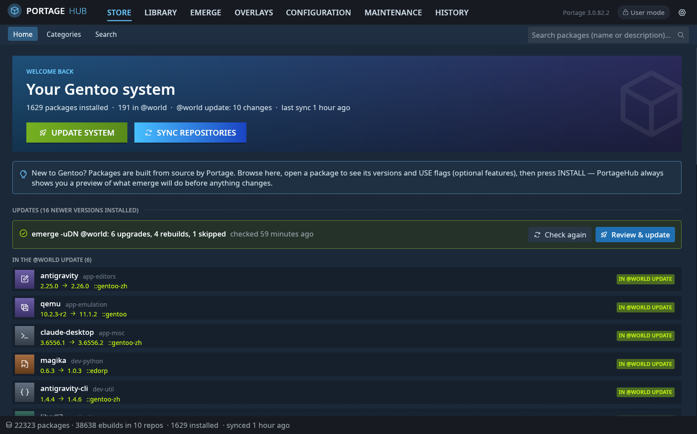
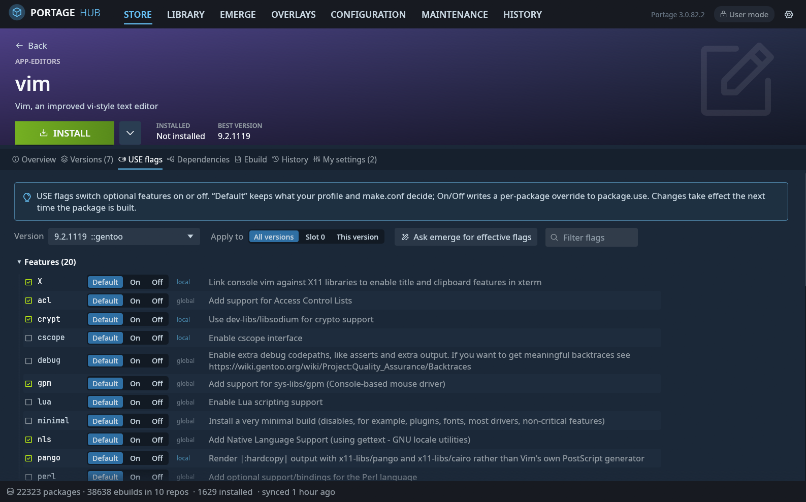
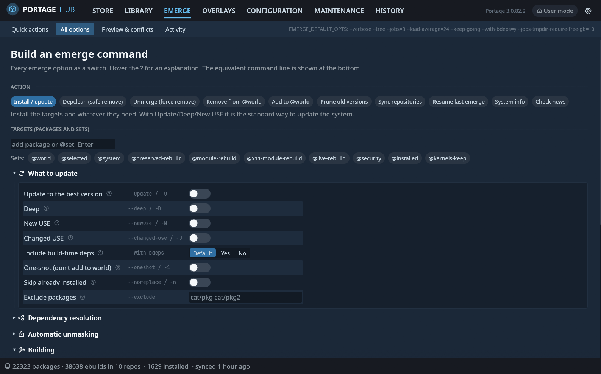
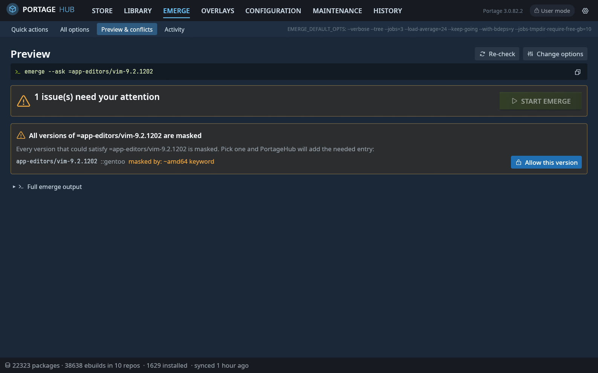
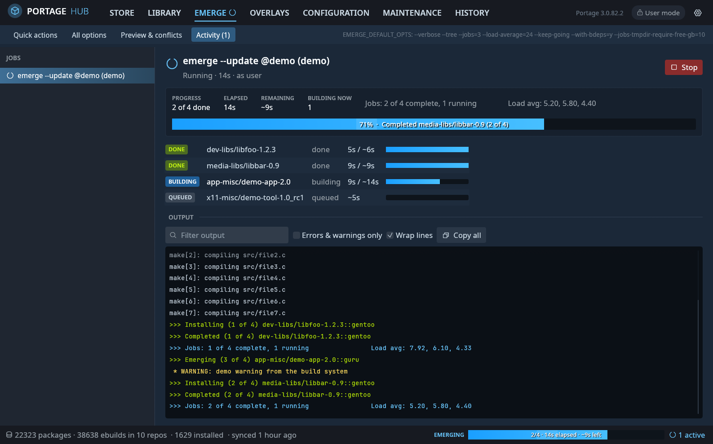
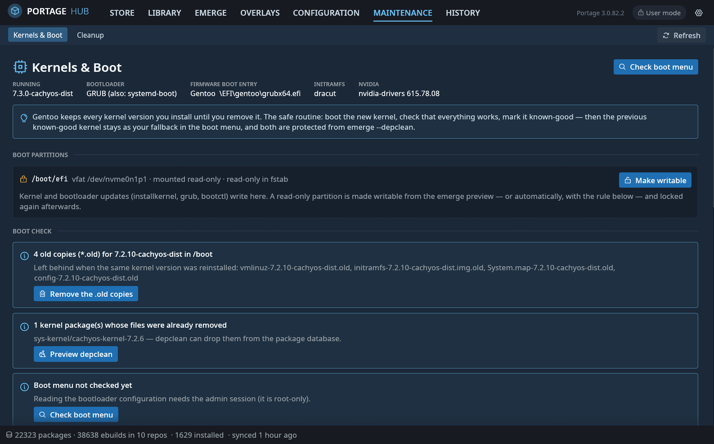

# PortageHub

A Steam-styled graphical front end for Gentoo's Portage, written in Rust (egui/eframe).
Everything you would do with `emerge`, `eselect repository` and the files in
`/etc/portage` is available as buttons, switches and menus — with plain-language
explanations for newcomers and every expert option still within reach.

## Screenshots

| | |
|---|---|
|  |  |
| **Store** — your system at a glance; updates checked against `emerge -uDN @world` | **Package page** — USE flags as switches, with descriptions and scope |
|  |  |
| **All options** — every emerge flag as a switch, radio or number field | **Preview & conflicts** — problems turned into one-click fixes |
|  |  |
| **Activity** — per-package stages, elapsed and remaining time, live log | **Kernels & Boot** — known-good kernels, boot partitions, boot check |

## Features

- **Store** — browse all packages from every repository, category tiles, fast search
  (name or description, per-repository filter), possible updates, unread news.
- **Library** — installed packages Steam-library style: filter by @world, dependencies,
  updates or orphans (installed but no longer in any repository).
- **Package page** — big INSTALL / UPDATE / REBUILD button with an options menu
  (specific version, slot, `--oneshot`, fetch only, binary packages, depclean, unmerge,
  @world select/deselect, `pkg_config`), and tabs for:
  - *Versions* grouped by slot with STABLE / TESTING / NO KEYWORD / LIVE / MASKED badges
    (including the reason from the repository's `package.mask`); click a version for
    install, keyword, mask/unmask and license actions.
  - *USE flags* with descriptions (`metadata.xml`, `use.desc`, `use.local.desc`,
    USE_EXPAND), a Default/On/Off switch per flag, scope (all versions / slot / version)
    and “ask emerge for the effective flags”.
  - *Dependencies* as a tree with USE conditionals, installed markers, click-through,
    and reverse dependencies.
  - *Ebuild* source with syntax highlighting, `files/` list; *Files* (CONTENTS);
    *History* (build times from `emerge.log`); *My settings* (every `/etc/portage`
    line affecting the package, with on/off switches).
- **Emerge** — one-click recipes (update @world, apply USE changes, preserved-rebuild,
  depclean, fetch only, resume, empty tree), and a builder that exposes every emerge
  option as a switch / yes-no-default / number field with help text and the equivalent
  command line. Every change runs as a **preview** first (`--pretend`), parsed into:
  - the merge list (NEW / UPDATE / REBUILD / DOWNGRADE / NEW SLOT, binaries, changed USE),
    estimated build time from your own history and download size;
  - **conflict handling**: autounmask suggestions as checkboxes you can apply in one
    click (then the preview re-runs), masked packages with “Allow this version”, slot
    conflicts with retry options (backtracking, full world update, verbose conflicts,
    autounmask backtracking), blockers, REQUIRED_USE, circular dependencies with USE
    fixes, ambiguous names, missing packages (search / find an overlay), news,
    preserved libraries and config-file updates.
- **Activity** — live progress of running emerges (also for parallel `--jobs`): per
  package stage (queued, building with the current phase from the build log,
  installing, done, failed), elapsed vs. expected time, overall progress and ETA,
  filterable coloured log, Stop / Resume / Resume-skip-first. A Steam-style
  “EMERGING” bar stays visible in the footer on every page.
- **Overlays** — repository cards (sync type, priority, ebuild count, last sync, masters,
  file), per-repo sync, `egencache`, inline repos.conf editing, remove/disable, the
  official overlay list (`eselect repository`), and custom git/rsync/hg/svn or local
  overlays.
- **Configuration** — every `package.*` file (`use`, `accept_keywords`, `mask`,
  `unmask`, `license`, `env`, `properties`, `accept_restrict`, legacy `keywords`,
  sets, profile overrides) in file or directory form: lines become rows with an
  on/off switch (comment/uncomment), edit, delete, a guided “add entry” wizard and a raw
  editor. Plus make.conf cards (MAKEOPTS sliders, branch, licenses, FEATURES chips,
  global USE, VIDEO_CARDS/INPUT_DEVICES, all variables with effective values),
  `/etc/portage/env` files with templates, profile switching, news, `._cfg` config
  updates with diffs, and a **stray-file detector** for files Portage silently ignores
  (e.g. `package.accept_keywordschatgpt-desktop`), which it can merge into the right place.
- **Maintenance → Kernels & Boot** — every installed kernel mapped to its package,
  /boot image, initramfs, /lib/modules and /usr/src tree, with RUNNING / LAST-GOOD /
  PREVIOUS-GOOD / NEWEST tags. A boot check reads the root-only bootloader files
  through the helper (GRUB, systemd-boot, LILO; rEFInd/Limine/EFI stub detected) and
  reports kernels missing from the menu, stale entries, missing initramfs or modules,
  a LILO that was not re-run, and offers the fix (grub-mkconfig, lilo, bootctl update,
  dracut, emerge --config). **Known-good rules**: mark the running kernel known-good
  (optionally only after nvidia-smi works), keep a backup in /boot/kernel-backup, and
  protect the last two known-good kernels from depclean through a set in @world
  (compatible with /var/lib/kernel-fallback and @kernels-keep). Old-kernel cleanup never
  touches the running or known-good kernels and can refuse until the newest kernel is
  marked. **NVIDIA**: checks that every kernel has an nvidia.ko matching the installed
  driver and alerts after kernel or driver updates, with the right rebuild option for
  dist-kernel and non-dist-kernel setups.
- **Boot partition pre-flight** — when a preview contains kernel or bootloader packages,
  PortageHub checks that /boot, /boot/efi and /efi are mounted read-write. A read-only
  EFI partition (e.g. `ro` in fstab) is remounted with one click (`mount -o remount,rw`)
  and locked again when the emerge finishes; an optional rule does both automatically.
- **Maintenance → Cleanup** — unused packages (depclean scan with Keep/Remove per
  package), old kernels and /boot leftovers, distfiles and binary packages (eclean),
  old build logs, failed build directories, world-file entries for uninstalled
  packages, dead or no-longer-needed /etc/portage lines, preserved libraries and read
  news.
- **History** — every merge, failure, removal and emerge command from `emerge.log`,
  compile-time totals and a per-day chart.

Every write to `/etc/portage` is shown as a diff first (can be turned off) and written
atomically; new entries go to a dedicated `zz-portagehub` file in each directory. A file
that cannot be read as UTF-8 text, or that is a symlink, is shown with the reason and never
edited, and a write is refused if the file changed on disk after PortageHub read it.

## Build and run

```sh
cargo build --release
./target/release/portagehub
```

Keep `portagehub` and `portagehub-helper` next to each other (or install them, below).
Your user should be in the `portage` group so the History page and the *Recently installed*
list can read `/var/log/emerge.log`. The live per-package phase in Activity does not need
it: it follows emerge's own output, because Portage keeps its build directories private to
the `portage` user.

### Administrator rights

Browsing and previews run as your user. The first action that needs root starts
`portagehub-helper` through **pkexec**; polkit asks for your password once, when that admin
session starts.

**What an admin session is.** While it is open, PortageHub can run package-manager
commands and rewrite `/etc/portage` as root, replace configuration files below `/etc`,
change boot files and kernels and remount boot partitions. That is equivalent to full
administrator access, so start a session only on a desktop you trust. The helper checks
every request: it runs only `emerge`, `emaint`, `eselect`, `egencache`, `emerge-webrsync`,
`env-update`, `glsa-check`, `eclean-dist`, `eclean-pkg` and `portageq`; for `emerge` it accepts
only options it knows, spelled in full (Portage resolves abbreviations such as `--sys=` to
`--sysroot`), and package atoms or `@sets` as targets, never a path; it writes only below
`/etc/portage`, without following symlinks, and refuses `bashrc`, `postsync.d`,
`env/<category>/<package>` (sourced as bash by every build), `patches/` and `._cfg` names. These
checks guard against mistakes and against other programs of the same user riding along; they
are not a sandbox against the person who authenticated. A few settings run commands as
root by design (`FETCHCOMMAND` and `PORTAGE_BASHRC` in make.conf, a `repos.conf` entry that
points outside `/var/db/repos`): the review dialog flags them in red before you apply.

The other operations have arguments the helper fixes or validates itself: accepting or
discarding `._cfg` config updates below `/etc`, a read-only boot scan,
grub-mkconfig/lilo/bootctl/dracut, remounting only /boot, /boot/efi or /efi
read-write/read-only, recording known-good kernels in `/var/lib/kernel-fallback` (or
`/var/lib/portagehub/kernels`) with a pruned backup in `/boot/kernel-backup`, and deleting
files of kernels that no installed package owns (never the running or a known-good kernel).

**How long it lasts.** The session stays open until you press *End admin session* in
Settings, quit PortageHub, or it has been idle for 15 minutes (no request and no running
job); the next admin action then asks for your password again. If you close PortageHub during
an emerge, the helper keeps the emerge running until it finishes (or choose *Stop emerge and
quit* in the close dialog). *Force stop* in Activity sends SIGINT, then SIGTERM after 10
seconds and SIGKILL after 10 more.

**Log and undo.** Everything the helper is asked to do and how it ended goes to
`/var/log/portagehub/audit.log` (readable by the `portage` group, rotated once at 5 MiB);
PortageHub tells you if the log cannot be written. Changes to several files at once (turning
`package.use` into a directory, accepting config updates, marking a kernel known-good) run as
one recorded transaction: if a step fails, everything is rolled back, and
*Configuration → Recent changes* (or the *Undo* strip right after saving) restores the files,
refusing when one of them was edited since. *Accept all* for config updates shows every diff
first and leaves out files that can lock you out (SSH, PAM, sudo, fstab, polkit, accounts,
GRUB defaults).

After updating PortageHub, run `sudo dist/install.sh` again — the app warns when the
installed helper is older than the GUI.

To install system-wide (adds the polkit policy so the prompt shows a proper message):

```sh
cargo build --release
sudo dist/install.sh                      # /usr/bin and /usr/libexec
sudo PREFIX=/usr/local dist/install.sh    # /usr/local/bin and /usr/local/libexec
```

`PREFIX` chooses where the program and the helper go; the polkit policy is written for that
helper path (polkit identifies the helper by it) and always lands in
`/usr/share/polkit-1/actions`. `DESTDIR` stages everything below another directory for
packaging. The Gentoo ebuild installs to `/usr`.

### Troubleshooting

- *"No polkit authentication agent is running in this session"* — pkexec has nobody to ask
  for the password. Start your desktop's polkit agent (`polkit-kde-agent`,
  `polkit-gnome-authentication-agent-1`, `lxqt-policykit`, …); minimal window managers do not.
- *PortageHub cannot open a window* — it prints the reason and a hint. Software-only machines
  and some virtual machines work with `WGPU_BACKEND=gl portagehub` (OpenGL, via Mesa);
  `WGPU_BACKEND=vulkan` forces Vulkan.
- *Everything is read-only for one file* — the Configuration page says why: not valid UTF-8,
  not readable by your user, or a symlink (the helper never writes through one, because the
  link target would decide where root writes).

### Environment variables

| Variable | Purpose |
| --- | --- |
| `PORTAGEHUB_ELEVATE` | Launcher for the helper: `pkexec` (default), another command such as `doas`, or `none` to run it unprivileged (testing). |
| `PORTAGEHUB_HELPER` | Absolute path of the helper binary to use instead of the one next to the GUI or in `/usr/libexec`. |
| `PORTAGEHUB_ROOT` | Work on a scratch tree instead of `/` (used by the tests; honoured only when not running as root). |
| `PORTAGEHUB_IDLE_SECS` | Idle limit of the helper in seconds (tests only; honoured only when not root; the real limit is 15 minutes). |
| `PORTAGEHUB_DEMO=1` | Replays a synthetic parallel emerge to try the progress view without building anything. |
| `PORTAGEHUB_SCRIPT` | UI automation for screenshots, e.g. `tab=library;open=app-editors/vim;dtab=use;wait=2;shot=/tmp/vim.png;exit`. |

`portagehub --self-test` prints what was read from your system (repositories, tree,
installed packages, history, masks, configuration, update estimate) without opening a window.

## Tests

```sh
cargo test
```

Unit tests cover PMS version ordering, atoms, dependency strings, repos.conf,
make.conf, `package.*` parsing and editing, the pretend-output parser, progress tracking
and emerge.log parsing; the integration test drives the real helper binary over its
protocol.
